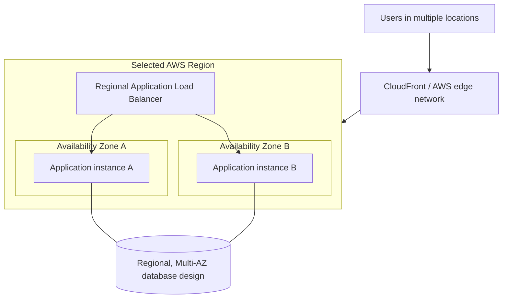

# AWS Global Infrastructure: Regions, Availability Zones, and Edge Locations

> **AWS Certified Solutions Architect – Associate (SAA-C03)** | Learning portfolio notes  
> **Status:** Detailed study notes | **Reviewed:** 18 November 2026  
> **Exam relevance:** Resilient, high-performing, secure, and cost-optimized architectures  
> **Keywords:** Region, Availability Zone (AZ), fault isolation, multi-AZ, multi-Region, edge location, latency, data residency

## Learning objectives

After studying this chapter, I should be able to:

1. Explain the difference between a **Region**, **Availability Zone**, and **edge location**.
2. Select a Region based on **compliance, proximity, service availability, and price**.
3. Design an application to tolerate an AZ failure and recognize when **multi-Region** is justified.
4. Identify **global**, **Regional**, and **zonal** AWS resources, including exceptions.
5. Explain the role of CloudFront and AWS Points of Presence (PoPs).

---

## 1. Big picture: How AWS infrastructure is organized

AWS operates a worldwide cloud infrastructure. Its major geographic and network concepts are:

- **AWS Region:** a separate geographic area containing multiple Availability Zones.
- **Availability Zone (AZ):** one or more physically separate data centers with independent infrastructure and redundant power, networking, and connectivity, located within a Region.
- **Edge location / Point of Presence (PoP):** a location on AWS's global edge network that can serve or route user traffic close to end users, for services such as Amazon CloudFront and Amazon Route 53.
- **Regional edge cache:** an additional caching tier for CloudFront; it is not an AZ and is not a general-purpose AWS Region.

### Conceptual diagram

**Interpretation:** Users can connect through nearby edge locations while the application runs in a selected Region across two or more AZs. Edge locations do **not** automatically replicate your application's compute or database into every city.

> **Remember:** Region = **geographic isolation**; AZ = **failure isolation within a Region**; edge = **network proximity to users**.

---

## 2. What is an AWS Region?

A **Region** is a distinct geographic area where AWS operates infrastructure. Examples include:

| Region name | Region code | Example audience |
| --- | --- | --- |
| Europe (Frankfurt) | `eu-central-1` | Workloads located in Germany / central Europe |
| Europe (Ireland) | `eu-west-1` | Workloads serving European users |
| Asia Pacific (Mumbai) | `ap-south-1` | Workloads serving users in India |
| US East (N. Virginia) | `us-east-1` | Workloads serving US users and selected global-service control planes |

These are examples, **not** a definitive ranking of latency, compliance suitability, or cost.

### Region characteristics

- Regions are designed to be geographically isolated from one another, reducing correlated infrastructure failures.
- Each AWS Region includes **at least three Availability Zones** in the AWS public commercial infrastructure (do not memorize an arbitrary maximum such as six).
- Most AWS workload services are **Regional**: you choose a Region to deploy them.
- Creating a resource in one Region generally does **not** create that resource in another Region. Cross-Region replication and transfers depend on explicit configuration and individual service behavior.
- Global services, support functions, service-specific data flows, and chosen cross-Region features are important exceptions. **Never interpret data residency as a universal guarantee that no data of any kind leaves a Region.** Review individual service documentation, data processing terms, and regulatory requirements.

### Region vs country

A Region has a physical location and a specific code. Multiple Regions may exist in one country, and the presence of a Region within a country does **not by itself** prove compliance with every applicable regulation. Compliance involves legal, technical, operational, and contractual controls.

---

## 3. How to choose an AWS Region

My shorthand: **C-P-A-P = Compliance, Proximity, Availability of services, Price.**

### 3.1 Compliance and data residency

**Question:** Must certain customer data stay in a country, legal jurisdiction, or approved geographic area?

Consider:

- Data residency and sovereignty requirements.
- Applicable laws and sector rules (for example, GDPR considerations, where relevant).
- Contractual data-location commitments.
- Backup, disaster recovery, logs, observability, support, and cross-Region replication settings.
- Whether each selected AWS service meets the necessary compliance requirements.

**Example:** A German customer requires primary application data to remain in an approved EU location. Frankfurt (`eu-central-1`) may be a suitable starting candidate. The architect must still validate compliance and service-specific data flows; choosing Frankfurt alone does not automatically guarantee GDPR compliance.

**Exam decision:** If the question states that the workload **must** run in a particular location for regulatory reasons, treat that as a primary constraint before optimizing price.

### 3.2 Proximity to users (latency)

**Question:** Where are users located, and how sensitive is the application to network delays?

- Placing compute and databases nearer users can reduce round-trip network latency.
- CloudFront can accelerate delivery of eligible content via nearby edge locations.
- Measure actual network paths rather than assuming physical distance always predicts best performance.
- For a globally distributed audience, consider CloudFront, routing strategy, or multi-Region deployment when justified.

**Example:** An interactive application used mostly in Mumbai might be evaluated first in `ap-south-1`. Users in Europe may need a different design if response times are unacceptable.

### 3.3 Available services and features

**Question:** Are all required AWS services, instance types, features, and quotas available in the candidate Region?

- New services or features may launch in only some Regions.
- Instance families and service quotas vary by Region.
- Verify the AWS Regional Services list and service-specific documentation *before* committing to a Region.

**Exam decision:** If a mandatory feature is unavailable in your preferred Region, evaluate a supported Region or change the design, while respecting compliance requirements.

### 3.4 Pricing and total cost

**Question:** What will the workload actually cost in each candidate Region?

- Prices for compute, storage, managed databases, and other services may vary by Region.
- Include **data transfer**, cross-AZ or cross-Region traffic where applicable, and support/operational trade-offs.
- A cheaper compute instance does not always mean a cheaper end-to-end architecture.
- Use the official service pricing pages and [AWS Pricing Calculator](https://calculator.aws/) for current estimates.

**Exam decision:** When all other requirements are met, select the solution that satisfies the requirements at the lowest appropriate total cost—not merely the lowest displayed EC2 hourly rate.

### Decision matrix: practical prioritization

| Factor | Question to ask | Typical architectural effect |
| --- | --- | --- |
| **Compliance** | Is there a mandatory location or legal restriction? | May exclude Regions entirely |
| **Proximity** | Where are users; is low latency required? | Influences primary Region and edge strategy |
| **Availability** | Are all services/features offered there? | Determines technical feasibility |
| **Pricing** | What is full monthly cost, including transfer? | Chooses among feasible alternatives |

**My workflow:** (1) eliminate noncompliant choices → (2) confirm required services → (3) test latency → (4) compare total cost → (5) document the decision.

---

## 4. What is an Availability Zone (AZ)?

An **Availability Zone** is an isolated location *inside* an AWS Region. It comprises **one or more discrete data centers**, with redundant power, networking, and connectivity.

### Core characteristics

1. **Fault isolation:** AZs use separate physical facilities and infrastructure to reduce the risk that a localized incident affects all AZs simultaneously.
2. **Networking:** AZs in a Region are linked via dedicated, high-bandwidth, low-latency, highly redundant networking.
3. **Availability:** Each Region has **at least three AZs**. The exact number depends on the Region and can change.
4. **Customer design:** AWS provides separated infrastructure, but **you must distribute application resources across AZs** to benefit from AZ fault isolation.
5. **Shared regional risk:** Multiple AZs reduce exposure to an AZ failure, but do **not** eliminate every potential Regional or application-level failure.

### AZ names and IDs (important nuance)

An AZ name looks like `eu-central-1a`. Its **AZ ID** identifies the physical AZ consistently across accounts (for example, an ID formatted like `euc1-az1`). For AWS accounts created before November 2025 in some older Regions, letter-suffixed AZ names could map to different physical AZs across accounts; newer accounts have consistent AZ-name mapping. **Use AZ IDs when cross-account physical-AZ alignment matters.**

### Multi-AZ architecture example

Imagine an e-commerce site:

- An **Application Load Balancer (ALB)** accepts requests.
- Application servers are distributed across **AZ A and AZ B**.
- **EC2 Auto Scaling** keeps sufficient application capacity in the enabled AZs.
- An **Amazon RDS Multi-AZ deployment** provides database high availability using the chosen Multi-AZ configuration.

If one AZ becomes unavailable, traffic can be served by healthy resources in another AZ, **provided** the load balancer, application capacity, dependencies, failover configuration, and database design support that scenario.

> **Architecture lesson:** Two servers in the **same** AZ are not equivalent to two servers across **different** AZs.

### What AZ isolation does not solve

- A user deletes critical production data.
- An application deployment introduces a bug to every instance.
- Bad credentials or a security incident compromises the application.
- A Region-wide service disruption affects the architecture.

Use appropriate backup, versioning, access controls, testing, recovery, and potentially **multi-Region** design for these risks.

---

## 5. Multi-AZ vs multi-Region

| Design | What it addresses | Typical trade-off |
| --- | --- | --- |
| **Single AZ** | Simple learning or noncritical workload | AZ failure can take down the workload |
| **Multi-AZ, one Region** | Availability against an AZ failure | More components and sometimes additional cost |
| **Multi-Region** | Regional disaster recovery, global latency, or geographic requirements | More expensive and complex replication, routing, consistency, and recovery |

### Practical decision examples

**Scenario A: E-commerce availability.** A business wants continued service if one data center location fails. **Choose multi-AZ deployment within a Region** as a sensible starting architecture.

**Scenario B: Region-level disaster recovery.** A business requires recovery from loss of an entire Region. A multi-AZ application in one Region is **insufficient**; consider a multi-Region disaster recovery architecture, clear recovery objectives, and practiced failover.

**Scenario C: Fast content delivery worldwide.** Static site assets should load quickly for globally dispersed users. **Consider Amazon CloudFront** in front of an origin; replicating the entire application across Regions is not always necessary.

**RTO** (Recovery Time Objective) = how quickly a service must be restored.  
**RPO** (Recovery Point Objective) = how much data loss, measured in time, the business can tolerate.

---

## 6. AWS Points of Presence (PoPs) and edge locations

**PoPs** are AWS global network locations used by edge-enabled services to bring content and routing closer to users. **Amazon CloudFront**, for example, uses edge locations to cache and deliver suitable content.

### Example: CloudFront request flow

1. A user in Berlin requests an image from an application whose origin is in an AWS Region.
2. DNS and CloudFront routing direct the request to an appropriate CloudFront edge location.
3. If the object is already cached and valid at the relevant edge cache, CloudFront can respond without retrieving it from the origin.
4. Otherwise, CloudFront retrieves it from the configured origin and can cache the response under the applicable policies.

**Benefits:** faster eligible content delivery, reduced origin load, and integration with AWS edge security and networking capabilities.

**Important distinctions:**

- An **edge location is not an AZ**.
- An **edge location is not a general compute Region**.
- Not every request is cached; behavior depends on cache policies, HTTP methods, headers, and object characteristics.
- CloudFront does **not** automatically make your database multi-Region or your application immune to a Regional origin failure.
- PoP totals change frequently. Your rough-note figure of **400+ PoPs** is a historical snapshot and should **not be memorized as a fixed exam fact**; check [AWS Global Infrastructure](https://aws.amazon.com/about-aws/global-infrastructure/) for the latest count and scope of the metric.

---

## 7. Global services vs Regional services vs zonal resources

This distinction is about **where a service's resources or control plane are managed**, not a promise that all data or processing is restricted to one location.

### 7.1 Global-service examples

| Service | Primary purpose | Scope / caveat |
| --- | --- | --- |
| **AWS IAM** | Identities, policies, permissions | Primarily global IAM resources; note service/control-plane nuances |
| **Amazon Route 53** | DNS and related routing functions | Public DNS/global service; some features have specific scoping rules |
| **Amazon CloudFront** | Global content delivery network | Global distribution with edge locations; origins may be Regional |
| **AWS WAF for CloudFront** | Web request filtering at CloudFront | **Global (CloudFront)** scope, managed through `us-east-1` |

### 7.2 Regional-service examples

| Service | What it does | Typical scope |
| --- | --- | --- |
| **Amazon EC2** | Virtual servers | EC2 is a Regional service; individual instances are placed in an AZ |
| **AWS Elastic Beanstalk** | Managed application deployment platform | Environment is created within a selected Region |
| **AWS Lambda** | Serverless functions | Functions deployed in a selected Region |
| **Amazon Rekognition** | Managed image/video analysis APIs | Regional endpoints and service availability |
| **AWS WAF for regional resources** | Protects a Regional ALB, API, etc. | Web ACL must be in the Region of the protected resource |

**Correction to my rough notes:** AWS WAF is **not exclusively global**. With **CloudFront**, it uses global scope and `us-east-1`; with supported Regional resources, it uses **Regional scope**.

### 7.3 Zonal-resource examples

- An **EC2 instance** runs in a particular AZ.
- An **EBS volume** is an AZ-scoped block-storage resource and ordinarily attaches to a compatible instance in that same AZ.
- A **subnet** belongs to one AZ even though the **VPC** spans a Region.

> **Exam trap:** "EC2 is Regional" and "an EC2 instance is zonal" can both be true. Service scope and individual-resource placement are not identical concepts.

### Classification summary

| Infrastructure concept | Examples | Primary purpose |
| --- | --- | --- |
| **Global** | IAM, Route 53 public DNS, CloudFront | Shared/global functionality or worldwide delivery |
| **Regional** | Lambda, Rekognition, an RDS deployment, VPC | Workload deployment and management in a Region |
| **Zonal** | EC2 instance, EBS volume, subnet | Resource placement and failure domain within a Region |
| **Edge** | CloudFront PoP | Serve and route traffic close to users |

---

## 8. Architect's comparison: similar-sounding AWS locations

| Concept | What it is | Primary problem solved |
| --- | --- | --- |
| **Region** | Geographic AWS area with multiple AZs | Compliance, workload location, regional isolation |
| **Availability Zone** | Isolated data-center location(s) in a Region | Tolerance of AZ failures |
| **CloudFront edge location** | Edge-network delivery point | Speed/caching and edge functions close to users |
| **Local Zone** | AWS infrastructure extension near a metropolitan area | Selected workloads requiring low latency near users |
| **Wavelength Zone** | AWS infrastructure at a telecom provider edge | Selected workloads needing very low latency to 5G users |

**SAA-C03 guidance:** Do not choose a Local Zone, Wavelength Zone, or Edge Location merely because an exam question says “high availability.” First identify whether the problem concerns **low latency**, **AZ failure**, or **Region failure**.

---

## 9. Knowledge checks: SAA-style scenarios

These are **original practice scenarios**, not copied or leaked certification questions.

**Q1.** A company has a web application on one EC2 instance in one AZ. It must remain available during an AZ outage. What is the architectural direction?

Answer
Use an ALB and application capacity in at least two AZs, plus a suitable highly available data layer. Simply adding another instance in the same AZ is not enough.

**Q2.** A workload must use a service feature available only in a certain Region, but customer data is subject to a mandatory data-residency requirement. What should be evaluated first?

Answer
Both are hard constraints. Validate compliant supported Regions or redesign the solution; do not ignore data residency simply because a desired feature is available elsewhere.

**Q3.** A company serves product images worldwide. The origin is already resilient, but distant users experience slow image delivery. What is a likely improvement?

Answer
CloudFront, with appropriate cache behavior, can reduce delivery latency without requiring duplicate EC2 fleets around the world.

**Q4.** You need AWS WAF in front of a CloudFront distribution. Which deployment scope and control-plane Region are relevant?

Answer
Use AWS WAF CloudFront/global scope; configure it through `us-east-1`.

**Q5.** An EC2 instance resides in `eu-central-1a`. Is it inherently protected if that AZ becomes unavailable?

Answer
No. EC2 instances are placed in an AZ; application-level multi-AZ architecture is needed to tolerate loss of the AZ.

**Q6.** An architect deploys two servers in different AZs but stores all critical application state on one EBS volume attached to one instance. Is the system fully AZ resilient?

Answer
No. The single-AZ state dependency remains a single point of failure. Design an appropriate multi-AZ state layer and recovery method.

---

## 10. Quick revision sheet

| Prompt | Answer to remember |
| --- | --- |
| What is an AWS Region? | Separate geographic area containing multiple isolated AZs |
| Minimum number of AZs in a public AWS Region? | **At least 3** |
| Is there a fixed maximum of 6 AZs? | **No; do not assume one** |
| What is an AZ? | One or more discrete data centers with redundant infrastructure |
| AZ networking within a Region? | Low-latency, high-bandwidth, highly redundant |
| Four Region-selection criteria? | **Compliance, proximity, available services, price** |
| What provides AZ-failure resilience? | A correctly designed **multi-AZ** architecture |
| What protects against Region-wide failure? | A suitable **multi-Region** recovery design |
| Why CloudFront? | Deliver eligible content near users using AWS edge locations |
| IAM / Route 53 / CloudFront? | Common examples of **global services** |
| EC2 / Lambda / Rekognition? | Common **Regional-service** examples |
| AWS WAF scope? | **Global for CloudFront**; **Regional for supported regional resources** |
| Is an EC2 instance Regional or zonal? | **Zonal resource** within a Regional service |
| Does selecting a Region guarantee compliance automatically? | **No** |

### Short memory model

**Region:** *Where should I operate?*  
**AZ:** *How do I survive a local infrastructure failure?*  
**Edge:** *How do I reach users faster?*  
**Multi-Region:** *How do I respond to a Region-wide failure?*

---

## 11. Further reading — official AWS sources

1. [AWS Regions and Availability Zones — User Guide](https://docs.aws.amazon.com/global-infrastructure/latest/regions/aws-regions-availability-zones.html)
2. [AWS Availability Zones — minimum AZ count and AZ identifiers](https://docs.aws.amazon.com/global-infrastructure/latest/regions/aws-availability-zones.html)
3. [AWS Global Infrastructure — live footprint](https://aws.amazon.com/about-aws/global-infrastructure/)
4. [AWS Fault Isolation Boundaries — Regions](https://docs.aws.amazon.com/whitepapers/latest/aws-fault-isolation-boundaries/regions.html)
5. [AWS Fault Isolation Boundaries — global services](https://docs.aws.amazon.com/whitepapers/latest/aws-fault-isolation-boundaries/global-services.html)
6. [AWS service endpoints and Region codes](https://docs.aws.amazon.com/general/latest/gr/rande.html)
7. [AWS WAF supported global and Regional resources](https://docs.aws.amazon.com/waf/latest/developerguide/how-aws-waf-works-resources.html)
8. [AWS guidance for choosing Regions](https://docs.aws.amazon.com/whitepapers/latest/establishing-your-cloud-foundation-on-aws/get-started-cloud-services.html)
9. [AWS Pricing Calculator](https://calculator.aws/)

**Portfolio note:** This is an independent learning summary. AWS infrastructure counts, prices, available service features, and exact service-scoping rules evolve; always consult current AWS documentation for architecture decisions.

---

## Personal learning log

- **My own explanation of a Region:** _Add after revision._
- **My own explanation of an AZ:** _Add after revision._
- **One real application I could design across two AZs:** _Add a diagram or lab link._
- **My preferred Region for a sample workload and why:** _Compare compliance, latency, services, and cost._
- **What I still need to learn:** _Add questions after each study session._
